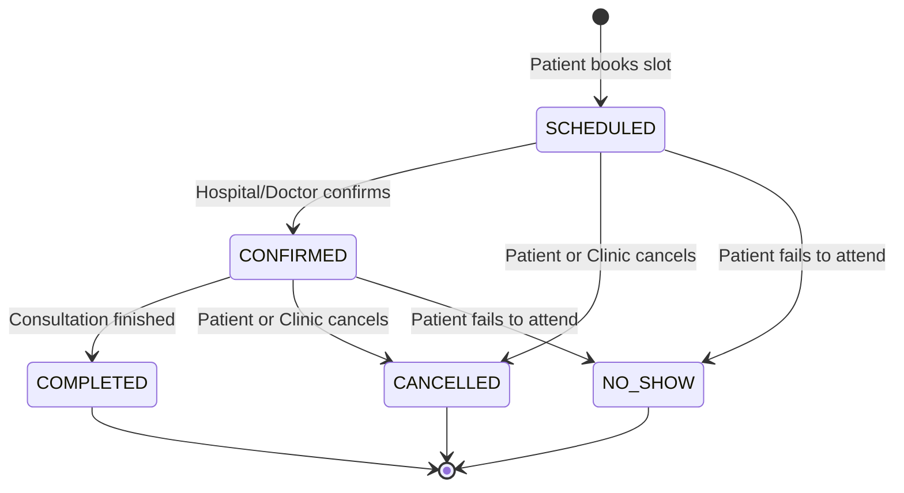

# MediSimbio Backend: Phase 4 Analysis & Appointment / Availability Architecture

## 1. Executive Summary & Objective

In **Phase 4**, we implement the **Appointment, Doctor Availability, and Consultation Booking** subsystem for MediSimbio:
1. **Doctor Availability Management Module** (`com.medisimbio.backend.appointment`)
2. **Dynamic Slot Generation Engine**
3. **Appointment Booking, Lifecycle, Cancellation, and Rescheduling**
4. **Patient, Provider, and Hospital Specific Views**

This subsystem provides the authoritative scheduling engine connecting patients, doctors, and hospitals with database-level double-booking protection and transactional integrity.

---

## 2. Domain Modeling & Relational Design

```
+--------------------+        +-----------------------+        +--------------------+
|     Providers      |<-------| DoctorAvailabilities  |------->|     Hospitals      |
| (Doctors/Clinics)  | 1    * | (Recurring Schedules) | *    1 | (Govt / Private)   |
+--------------------+        +-----------------------+        +--------------------+
          ^                                                              ^
          | 1                                                          1 |
          |                                                              |
          |               +-----------------------+                      |
          +---------------|     Appointments      |----------------------+
          | *             |  (Booking & Lifecycle)|                    * |
          |               +-----------------------+                      |
          |                           | *                                |
+--------------------+                |                                  |
|      Patients      |<---------------+                                  |
| (Identity/Profile) | 1                                                 |
+--------------------+                                                   |
          ^                                                              |
          | 1                                                          1 |
+--------------------+                                         +--------------------+
|      Med-IDs       |                                         |    Specialties     |
| (Authority Core)   |                                         | (Medical Domains)  |
+--------------------+                                         +--------------------+
```

### Relational Schema Specifications

#### 1. `doctor_availabilities` Table
| Column Name | Data Type | Constraints | Description |
| :--- | :--- | :--- | :--- |
| `id` | `UUID` | `PRIMARY KEY` | Immutable internal UUID |
| `provider_id` | `UUID` | `NOT NULL REFERENCES providers(id) ON DELETE CASCADE` | Doctor reference |
| `hospital_id` | `UUID` | `NOT NULL REFERENCES hospitals(id) ON DELETE CASCADE` | Hospital reference |
| `day_of_week` | `VARCHAR(20)` | `NOT NULL` | e.g. `MONDAY`, `TUESDAY`, etc. |
| `start_time` | `TIME` | `NOT NULL` | Operating window start (e.g. `09:00:00`) |
| `end_time` | `TIME` | `NOT NULL` | Operating window end (e.g. `13:00:00`) |
| `slot_duration_minutes` | `INTEGER` | `NOT NULL DEFAULT 30` | Duration per consultation slot |
| `active` | `BOOLEAN` | `NOT NULL DEFAULT TRUE` | Active schedule flag |
| `created_at` | `TIMESTAMP` | `NOT NULL DEFAULT CURRENT_TIMESTAMP` | Record creation timestamp |
| `updated_at` | `TIMESTAMP` | `NOT NULL DEFAULT CURRENT_TIMESTAMP` | Record modification timestamp |

#### 2. `appointments` Table
| Column Name | Data Type | Constraints | Description |
| :--- | :--- | :--- | :--- |
| `id` | `UUID` | `PRIMARY KEY` | Immutable internal UUID |
| `patient_id` | `UUID` | `NOT NULL REFERENCES patients(id) ON DELETE CASCADE` | Patient reference |
| `provider_id` | `UUID` | `NOT NULL REFERENCES providers(id) ON DELETE RESTRICT` | Doctor reference |
| `hospital_id` | `UUID` | `NOT NULL REFERENCES hospitals(id) ON DELETE RESTRICT` | Hospital facility reference |
| `specialty_id` | `UUID` | `NULLABLE REFERENCES specialties(id) ON DELETE SET NULL`| Medical specialty reference |
| `appointment_date` | `DATE` | `NOT NULL` | Clinic calendar date (YYYY-MM-DD) |
| `start_time` | `TIME` | `NOT NULL` | Consultation start time (HH:MM:SS) |
| `end_time` | `TIME` | `NOT NULL` | Consultation end time (HH:MM:SS) |
| `status` | `VARCHAR(20)` | `NOT NULL DEFAULT 'SCHEDULED'` | Lifecycle state enum |
| `booking_reference` | `VARCHAR(30)` | `NOT NULL UNIQUE` | Human-readable identifier (`MSB-YYYYMMDD-XXXX`) |
| `visit_reason` | `VARCHAR(500)` | `NULLABLE` | Patient-provided reason for visit |
| `cancellation_reason` | `VARCHAR(500)`| `NULLABLE` | Reason documented upon cancellation |
| `rescheduled_from_id` | `UUID` | `NULLABLE REFERENCES appointments(id)` | Audit link to prior appointment |
| `created_at` | `TIMESTAMP` | `NOT NULL DEFAULT CURRENT_TIMESTAMP` | Audit creation timestamp |
| `updated_at` | `TIMESTAMP` | `NOT NULL DEFAULT CURRENT_TIMESTAMP` | Audit update timestamp |

---

## 3. Concurrency Strategy & Double-Booking Protection

A core requirement in healthcare scheduling is preventing two simultaneous booking requests from occupying the same doctor or patient slot.

### Multi-Tier Defense Strategy:
1. **Application-Level Validation**: Query active bookings within the requested time window before persisting.
2. **Database-Level Partial Unique Constraints**:
   - **Doctor Double-Booking Protection**:
     ```sql
     CREATE UNIQUE INDEX idx_uq_active_doctor_slot 
     ON appointments (provider_id, appointment_date, start_time) 
     WHERE status NOT IN ('CANCELLED');
     ```
     Guarantees that a doctor cannot be double-booked across the entire platform for overlapping slots.
   - **Patient Overlap Protection**:
     ```sql
     CREATE UNIQUE INDEX idx_uq_active_patient_slot 
     ON appointments (patient_id, appointment_date, start_time) 
     WHERE status NOT IN ('CANCELLED');
     ```
     Guarantees a patient cannot book conflicting appointments simultaneously.
3. **Controlled Conflict Translation**: Database unique constraint violations (`DataIntegrityViolationException`) are captured and returned as HTTP `409 Conflict` with a clear message: `"The selected appointment slot has already been booked. Please choose another slot."`

---

## 4. Slot Generation Strategy

Slots are **dynamically calculated** on-demand rather than pre-populating millions of empty records into the database:
1. Verify requested `date` is today or in the future (`date >= LocalDate.now(Asia/Kolkata)`).
2. Fetch active `DoctorAvailabilityEntity` records for `providerId`, `hospitalId`, and `date.getDayOfWeek()`.
3. Generate consecutive time slots: `[startTime, startTime + slotDuration]`, ..., `[endTime - slotDuration, endTime]`.
4. If `date == today`, filter out slots whose `startTime <= LocalTime.now(Asia/Kolkata)`.
5. Query all non-cancelled appointments for the doctor on that date.
6. Filter out occupied slots, returning only available, bookable intervals.

---

## 5. Appointment Status Lifecycle



### Transition Invariants:
- `COMPLETED` is terminal. Cannot be cancelled or rescheduled.
- `CANCELLED` is terminal. Releasing the slot allows another patient to book it.
- `NO_SHOW` is terminal. Assigned only by authorized clinic operations.

---

## 6. Rescheduling Strategy

When a patient reschedules an appointment:
1. Original appointment must be in `SCHEDULED` or `CONFIRMED` status.
2. New requested slot must be valid and available.
3. In a single `@Transactional` boundary:
   - Mark original appointment as `CANCELLED` with `cancellation_reason = "Rescheduled to appointment " + newBookingReference`.
   - Create and save the new `AppointmentEntity` with `rescheduled_from_id = originalAppointment.getId()`.
4. This preserves the complete historical audit trail while freeing the previous slot.

---

## 7. REST API Contract Specifications

### 7.1 Doctor Availability APIs (`/api/v1/providers/{providerId}/availability`)
- `POST /api/v1/providers/{providerId}/availability`
  - **Auth**: Authenticated (Doctor/Hospital Admin)
  - **Body**: `CreateAvailabilityRequestDto` (`hospitalId`, `dayOfWeek`, `startTime`, `endTime`, `slotDurationMinutes`)
  - **Response**: `ApiResponse<AvailabilityResponseDto>` (`201 Created`)
- `GET /api/v1/providers/{providerId}/availability`
  - **Auth**: Public Read (`permitAll`)
  - **Query Params**: `hospitalId` (UUID), `dayOfWeek` (string), `active` (boolean)
  - **Response**: `ApiResponse<List<AvailabilityResponseDto>>`
- `PATCH /api/v1/providers/{providerId}/availability/{id}`
  - **Auth**: Authenticated
  - **Body**: `UpdateAvailabilityRequestDto`
  - **Response**: `ApiResponse<AvailabilityResponseDto>`
- `DELETE /api/v1/providers/{providerId}/availability/{id}`
  - **Auth**: Authenticated
  - **Response**: `ApiResponse<Void>`

### 7.2 Dynamic Slot APIs (`/api/v1/providers/{providerId}/slots`)
- `GET /api/v1/providers/{providerId}/slots`
  - **Auth**: Public Read (`permitAll`)
  - **Query Params**: `hospitalId` (UUID, required), `date` (LocalDate, required)
  - **Response**: `ApiResponse<List<SlotResponseDto>>`

### 7.3 Patient Appointment Booking & Management (`/api/v1/appointments`)
- `POST /api/v1/appointments`
  - **Auth**: Authenticated Patient (Identity resolved from `AuthenticationFacade`)
  - **Body**: `BookAppointmentRequestDto` (`providerId`, `hospitalId`, `specialtyId`, `appointmentDate`, `startTime`, `visitReason`)
  - **Response**: `ApiResponse<AppointmentResponseDto>` (`201 Created`)
- `GET /api/v1/appointments/me`
  - **Auth**: Authenticated Patient
  - **Query Params**: `status`, `from`, `to`, `date`, `page`, `size`, `sort`
  - **Response**: `ApiResponse<PageResponse<AppointmentSummaryDto>>`
- `GET /api/v1/appointments/me/{id}`
  - **Auth**: Authenticated Patient (Strict patient ownership verification)
  - **Response**: `ApiResponse<AppointmentResponseDto>`
- `POST /api/v1/appointments/{id}/cancel`
  - **Auth**: Authenticated Patient (or Clinic Admin)
  - **Body**: `CancelAppointmentRequestDto` (`cancellationReason`)
  - **Response**: `ApiResponse<AppointmentResponseDto>`
- `POST /api/v1/appointments/{id}/reschedule`
  - **Auth**: Authenticated Patient
  - **Body**: `RescheduleAppointmentRequestDto` (`newDate`, `newStartTime`, `newHospitalId`)
  - **Response**: `ApiResponse<AppointmentResponseDto>`

### 7.4 Provider & Hospital Views
- `GET /api/v1/providers/{providerId}/appointments`
  - **Auth**: Authenticated Provider / Admin
  - **Query Params**: `date`, `status`, `hospitalId`, `page`, `size`
  - **Response**: `ApiResponse<PageResponse<AppointmentSummaryDto>>`
- `GET /api/v1/hospitals/{hospitalId}/appointments`
  - **Auth**: Authenticated Hospital Admin
  - **Query Params**: `date`, `providerId`, `status`, `page`, `size`
  - **Response**: `ApiResponse<PageResponse<AppointmentSummaryDto>>`

---

## 8. Security, Privacy & Data Minimization

- **Patient Self-Service Isolation**: Endpoints under `/me` strictly resolve the authenticated user via `AuthenticationFacade`. Patients cannot view or modify appointments belonging to others.
- **Privacy Minimization**: Appointment summaries only expose doctor name, hospital name, date, time, status, and booking reference. No medical records, diagnoses, or prescriptions are attached.
- **Development vs. Production Auth**: The `DevAuthenticationFilter` simulates identities in dev/test via `X-User-Id` / `Authorization: Bearer <uid>`. In production, Spring Security OAuth2 Resource Server with JWT token verification will be attached.

---

## 9. Future Integration Points (Phase 5+)

1. **Payment Subsystem (Phase 5)**:
   - Future fields `paymentStatus`, `paymentReference`, `consultationFee` can attach seamlessly to `AppointmentEntity`.
   - Government hospitals will route to free / nominal registration fee flow; Private hospitals will route to consultation fee flow.
2. **Consultation Encounters & Prescriptions (Phase 6)**:
   - `EncounterEntity` will reference `AppointmentEntity` (`id`) to record doctor clinical notes, vitals, and digital prescriptions.
3. **Automated Notifications (Phase 7)**:
   - Triggers for booking confirmation, reminder SMS/WhatsApp 24h prior, and cancellation alerts.
4. **Emergency / 108 Integrations**:
   - Dedicated rapid walk-in triage overrides.

---

## 10. Scope Boundaries (Strictly NOT in Phase 4)

- No payment gateway integrations (Razorpay, Stripe, UPI).
- No medical record entries or prescription writing.
- No diagnostic lab order placements.
- No pharmacy dispensing.
- No video calling / telemedicine streaming.
- No external ABDM M1/M2/M3 token exchange.
